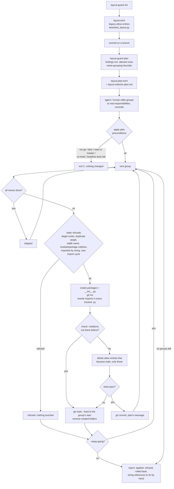

# layout-guard design

Python only, no hooks. Three parts, each usable without the next:

1. **`layout.toml` + checker** (`checker.py`). Declarative rules, stdlib only, one
   self-contained module (it imports nothing else from layout_guard) so `init --vendor` can copy
   it into a project verbatim.
2. **Adoption** (`scaffold/`). `init` infers the roots, writes `layout.toml` with today's
   problems as legacy `[[allow]]` entries, the layout test `tests/test_layout.py`, `AGENTS.md`,
   a `CLAUDE.md` that imports it, and optional pre-commit / GitHub Actions configs.
3. **Refactoring** (`refactor/`). `plan` writes the editable `layout-plan.toml`; `apply-plan`
   applies it one group at a time: move, rewrite imports, check, test, commit or roll back.

`install/` only copies the `python-layout-guard` skill folder.

## Plan / apply flow

## Decisions

- **The safeguard is a test, not a hook.** Hooks were not portable (one agent, one settings
  file, shell quoting per OS) and the checker plus a test that fails with the fix hint is enough:
  every agent and every CI runs tests. Nothing writes `settings.json`; the hooks, the hook
  subcommands, `check-file` (the hooks' per-write fast path), the watchdog and the fail-open log
  are gone.
- **How the test gets the checker:** vendored file if present, else `import layout_guard`, else
  **fail** with the instruction (never skip: a silent skip is indistinguishable from "layout
  fine"). `--vendor` exists for projects that must not add a dependency; the cost is a copy to
  refresh by hand.
- **Exceptions are data.** One `[[allow]]` mechanism for all rules, `reason` required, stale
  entries fail `check`, and `max` turns a folder exception into a ratchet. Legacy projects start
  green; only new violations fail.
- **The plan is the contract.** `apply-plan` applies exactly `layout-plan.toml`, so an agent or a
  human refines the heuristic's groups into responsibilities first and the file is reviewed and
  committed like code. The markdown is a generated summary, never input.
- **Transactional per group.** The whole group is computed in memory first (new contents of
  every file, string references, cycle check); only then is the tree touched. Only tracked
  files are edited, so `git reset --hard <start>` restores everything; the folders the group
  created are removed afterwards. A group is applied (one commit) or not at all.
- **What apply-plan may change in layout.toml:** delete the `[[allow]]` entries that the group
  made stale (only those: entries that were already stale stay, they are someone's decision), and
  add a new top-level package the plan creates to its root's `top_level` (the plan is the
  reviewed decision; otherwise the new package would fail `top-level` and the group could never
  apply). `[root.layers]` is never edited: a new package there is a design decision, so the group
  fails `check` and the message says to ask the user.
- **Import rewriting uses stdlib `ast`, not libcst.** `ast` gives exact start/end positions for
  every import statement, alias and attribute chain; replacing those spans (rather than
  unparsing) keeps comments and formatting. Only a statement that must be split or renamed is
  regenerated (and wrapped in parentheses past 99 columns); otherwise only the module token is
  replaced. libcst would add a runtime dependency for no case the tests exercise.
- **Bound names never change.** `from pkg import user_model` becomes
  `from pkg.user import model as user_model`, and `import server` becomes
  `import app.server as server`, so no other line of the importer has to change. For
  `import a.b.c`, the `a.b.c` attribute chains in that file are rewritten too.
- **Refuse rather than guess.** Name collisions, standard-library names, imports by string and
  new import cycles are refused before anything moves; string references in docs, mock targets,
  entry points and config files are reported with file:line for a human, never edited.
- **Cycle check:** module-level imports only (functions and `if TYPE_CHECKING:` excluded), plus
  the implicit edge from a module to its parent package's `__init__.py`; a package importing its
  own submodules (the re-export pattern) is not an edge. A cycle that did not exist before the
  move, modulo renames, refuses the group. The tests remain the final judge.
- **One-word module names** (`server`) are only reported as string references in module
  positions (`"server"`, `server.app`, `server:app`), not in prose.
